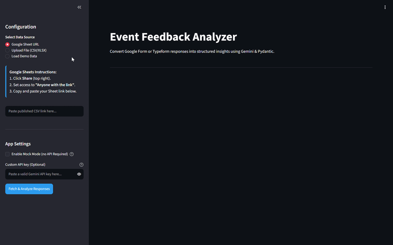
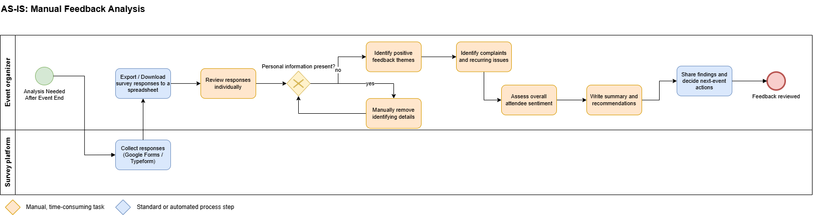
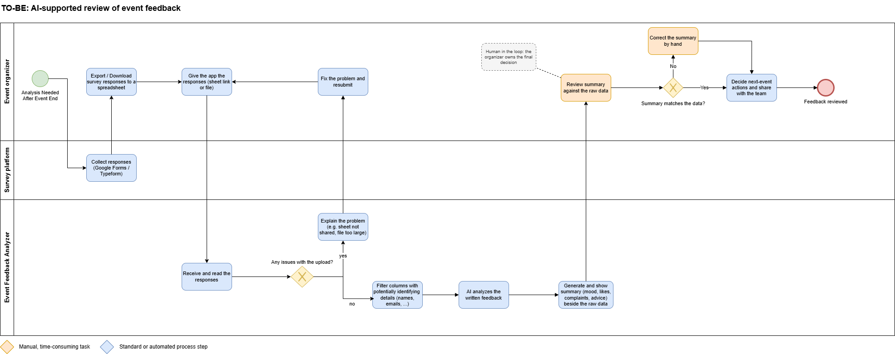
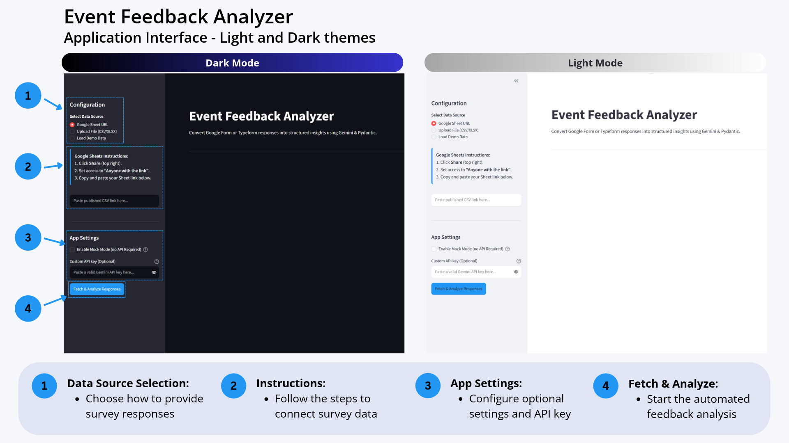

<a id="top"></a>

# Event Feedback AI Analyzer 

An AI-powered Streamlit dashboard designed to help student organizations and event leads process survey feedback efficiently, reduce the risk of exposing attendee details, and extract actionable insights using Gemini and Pydantic.

***The goal is simple:*** 
Spend less time sorting through feedback and more time using it to improve future events.

> **Live app:** [Open Event Feedback Analyzer](https://event-feedback-analyzer.streamlit.app/)



<details>
  <summary><b>Table of Contents</b></summary>

  1. [The Story: Why I Built This](#the-story-why-i-built-this)
  2. [Workflow](#workflow)
  3. [Features](#features)
  4. [Tech Stack](#tech-stack)
  5. [Design Choices](#design-choices)
  6. [Project Structure](#project-structure)
  7. [Getting Started](#getting-started)
      - [Prerequisites](#prerequisites)
      - [Installation](#installation)
        - [API Configuration](#api-configuration)
      - [Usage](#usage)
  8. [Limitations](#limitations)
  9. [Future Improvements](#future-improvements)
  10. [License](#license)

</details>

## The Story: Why I Built This

Imagine you've just wrapped up a small campus event or workshop with 20-30 attendees. The event went well, but you are now staring down a spreadsheet filled with dozens of free-text responses.

Even with a relatively small event, turning qualitative feedback into useful insights means manually reading responses, identifying recurring themes, evaluating sentiment, and deciding what to improve next time. Repeating this process for every event can become tedious,  especially at scale or under time constraints. 

If you try using a general-purpose LLM chatbot to handle this (e.g. ChatGPT, Claude, or Gemini) you run into a different set of headaches: 
- **Inconsistent outputs:** The formatting changes every time you run it, making it difficult to standardize feedback tracking. 
- **Privacy risks:** It is easy to paste names, emails, and other personal details into a public chat interface. 
- **Repeatability:** Every time you analyze a new batch of feedback, you have to rewrite the same detailed prompt to instruct the model.

That's why I built the **Event Feedback AI Analyzer**: To reduce that operational friction and make the process more structured, consistent, and repeatable. 

The application combines data preprocessing, Google's Gemini API, and Pydantic schema validation to transform survey responses into a structured summary of overall sentiment, attendee likes, complaints, and recommendations. 

It's a lightweight workflow-automation tool designed for student organizations and event leads who need the analytical power of large language models without the tedious setup. 

<p align="right">
    <a href="#top">^ Back to top</a>
</p>

## Workflow

The project aims to improve the traditional feedback-analysis process:

| AS-IS: Manual Analysis | TO-BE: AI-Assisted Analysis |
|---|---|
| Read responses individually | Process survey data through one workflow |
| Manually identify recurring themes | Generate AI-assisted summaries |
| Sort feedback into categories | Produce structured results |
| Manually identify and remove potentially identifying columns | Columns with potentially identifying names are filtered automatically |
| Repeat manual effort for each event | Reuse the same application workflow |

<details>
<summary><b>View BPMN Diagrams</b></summary>

**AS-IS: Manual Feedback Analysis**



**TO-BE: AI-Assisted Feedback Analysis**



</details><br>

**The application supports human review of the generated insights:**
The cleaned survey data is shown below the summary. AI-generated summaries should not be treated as a substitute for checking the underlying feedback. 

<p align="right">
    <a href="#top">^ Back to top</a>
</p>


## Features
- **Survey data ingestion:** Load feedback from a Google Sheets URL or upload a supported file.

- **PII-aware preprocessing:** Filter columns whose names indicate common identifying information before analysis.

- **AI-powered feedback analysis:** Use Google's Gemini API to summarize qualitative survey responses.

- **Structured output:** Validate the generated response against a Pydantic schema containing overall sentiment, top likes, top complaints, and recommendations.

- **Interactive dashboard:** Display the analysis in a Streamlit interface.

- **Mock Mode:** Explore the interface and example insights without requiring a live Gemini API call.

- **Error handling and retries:** Handle common API failures and retry selected temporary errors.

<details>
<summary><b>View Interface Overview</b></summary>

The applications supports both dark and light themes, with options for live analysis, different data sources, and a demo mode.



</details><br>

## Tech Stack

| Area | Tools |
|---|---|
| Language | Built on Python 3.14.7 |
| Web app | [Streamlit](https://streamlit.io/) |
| Data handling | [pandas](https://pandas.pydata.org/), openpyxl (XLSX files), Regular expressions |
| AI model | Google Gemini (`gemini-3.1-flash-lite`) via the [`google-genai`](https://pypi.org/project/google-genai/) SDK |
| Output validation | [Pydantic](https://pydantic.dev/docs/) |
| Configuration | python-dotenv |
| Process modelling | [Draw.io](https://www.drawio.com/) |

<p align="right">
    <a href="#top">^ Back to top</a>
</p>


## Design Choices
<details>
<summary><b>Why Google Gemini?</b></summary>

The application uses Google's Gemini API to analyze qualitative survey responses. A large language model is a suitable fit because responses are written in natural language and can express similar opinions in many different ways. The model can interpret comments in context and summarize positive and negative themes rather than relying only on manually defined keywords.

The project uses `Gemini 3.1 Flash-Lite` as its analysis model. The Flash-Lite model family is intended for lightweight, high-throughput tasks, making it a reasonable starting point for summarizing survey feedback. The project does not claim that this is the most accurate model. Model selection could be evaluated further by comparing output quality, response time, and API cost.

Another reason for choosing Gemini is its free API tier, which makes it more accessible for experimentation and development, particularly for students and independent developers. The free tier is subject to usage limits and Google's terms, and availability and pricing may change over time. 

For the latest details, see [Google's Gemini API Pricing](https://ai.google.dev/gemini-api/docs/pricing).

</details>

<br>
<details>
<summary><b>Why Streamlit?</b></summary>

Streamlit was chosen because the project is primarily a Python data-processing and AI workflow, rather than a complex web application. 

With my background in business rather than IT, it makes it easier to build an interactive interface directly in Python, keeping frontend code and overall project complexity low.

</details>

<br>
<details>
<summary><b>Why Pydantic?</b></summary>

Pydantic defines the expected structure of the AI-generated response. Without a defined schema, an LLM may return information in inconsistent formatting, making results harder to display reliably.

The `EventFeedbackSummary` schema specifies the required fields for sentiment, positive feedback, complaints, and recommendations. Gemini is asked to return output matching this format, and the response is parsed into the Pydantic model before it is displayed.  

Schema validation helps enforce the output's structure, but it does not guarantee that the model's interpretation or recommendations are factually correct.
</details>

<br>
<details>
<summary><b>Why Pandas and regular expressions?</b></summary>

Pandas is used to load, inspect and prepare survey data because the input is tabular and may contain a mix of structured fields and free-text answers. 

Regular expressions provide a lightweight, column-name-based filtering step to exclude fields that appear to contain common identifiers, such as names, email addresses, phone numbers, and network IDs. 

This helps reduce the amount of potentially identifying data being sent for analysis. It is not a complete PII-detection solution, particularly when personal information appears inside of the free-text responses. 

</details>


<br>
<details>
<summary><b>Why Mock Mode?</b></summary>

Mock Mode provides pre-generated example results without requiring a Gemini API key or making an external API request. This makes it easier to demonstrate and test the interface independently of API availability, quotas, or connectivity.

</details><br>

<p align="right">
    <a href="#top">^ Back to top</a>
</p>

## Project Structure
```
Event_Analyzer/
├── main.py                         # Streamlit entrypoint: ties the UI to the analysis
├── src/
│   ├── agent.py                    # Prompt building, Gemini call, retries, Pydantic schema
│   ├── utils.py                    # Loading data, Google Sheet URL conversion, PII-aware column filtering
│   └── ui/
│       └── components.py           # Sidebar, header, results and error display
├── assets/ 
│   ├── style.css                   # Custom styling
│   └── images/
│       ├── demo.gif                # Animated application demo
│       ├── workflow_as_is.png      # AS-IS BPMB diagram
│       ├── workflow_to_be.png      # TO-BE BPMB diagram
│       └── ui_overview.png         # An annotated overview of UI features
├── data/
│   ├── sample_feedback.csv         # Normal demo survey
│   └── test_injection.csv          # Prompt-injection test demo survey
├── requirements.txt
├── .env.example
├── .gitignore
└── README.md
```

<p align="right">
    <a href="#top">^ Back to top</a>
</p>


# Getting Started

## Prerequisites

- **Python 3.14.7** (the version the app was built and tested on). Other recent versions should work but haven't been tested.
- **Git** (Optional for cloning the repository)
- A **Gemini API key** from [Google AI Studio](https://aistudio.google.com/api-keys). (You can skip this to explore the app in Mock Mode)

## Installation

**1. Clone the repository**
```bash
git clone https://github.com/oliwier-ferenc/event-feedback-analyzer.git
cd event-feedback-analyzer
```

**2. Set up a virtual environment**
```bash
python -m venv .venv
```
Activate the environment:
```powershell 
# Windows (PowerShell)
.venv\Scripts\Activate.ps1 
```
```bash 
# macOS / Linux
source .venv/bin/activate
```

**3. Install dependencies and run**
```bash
pip install -r requirements.txt
streamlit run main.py
```
The application should open in your browser.

### API Configuration
To use the live analysis you need a [Gemini API key](https://aistudio.google.com/api-keys). You can provide it in either of two ways:

- **Sidebar:** Enter your API key directly in the application.
- **Environment variable:** Copy [`.env.example`](.env.example) to `.env` and replace the placeholder with your Gemini API key.

Alternatively, enable **Mock Mode** to explore the application using pre-generated example results without an API key.

## Usage

1. Choose a data source in the sidebar: **Google Sheet URL**, **Upload File (CSV/XLSX)**, or **Load Demo Data**.
2. For a Google Sheet, either publish it (**File > Share > Publish to web > CSV**) or set sharing to **Anyone with the link**, then paste the link.
3. Click **Fetch & Analyze Responses**.
4. Read the AI summary, then check against the survey data shown below it. 

No API key yet? Tick **Mock Mode** in the sidebar to see the interface populated with sample insights.

<p align="right">
    <a href="#top">^ Back to top</a>
</p>

## Limitations

- **Personal-data removal is a heuristic:** It looks at column names only, so personal details within free-text answers are not removed. Survey answers are sent to Google's Gemini API, so don't use surveys containing sensitive information.

- **Large surveys are truncated:** To limit API token usage, the text sent to the model has been capped (about 18,000 characters), so very large sheets are only partly analyzed.

- **AI summaries can be wrong or miss minority opinions:** This app is meant as a supporting tool, not a replacement. Always check the underlying survey responses.

- **Numeric ratings are not analyzed yet:** The summary is based on free-text answers.

- **API availability:** Live analysis depends on API access quotas, connectivity, and model availability.

- **Prompt-injection defences reduce the risk, but can't remove it.** 

## Future Improvements

Potential extensions include: 
- Exporting results to PDF or another shareable report format.
- Supporting additional data sources.
- Improving detection of personal information in free-text responses.
- Evaluating the quality of generated insights against manually reviewed feedback.
- Improved UI/UX design.

## License

The project is licensed under the [MIT License](LICENSE). See the [LICENSE](LICENSE) file for details.

<p align="right">
    <a href="#top">^ Back to top</a>
</p>
